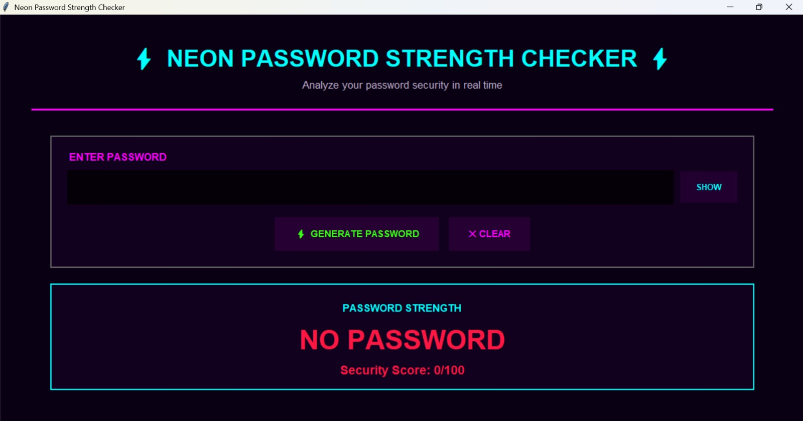
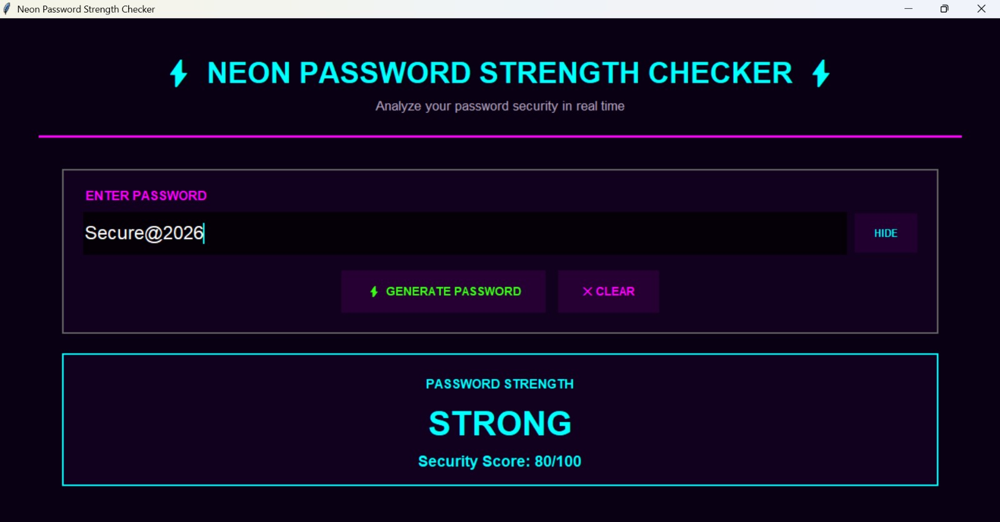
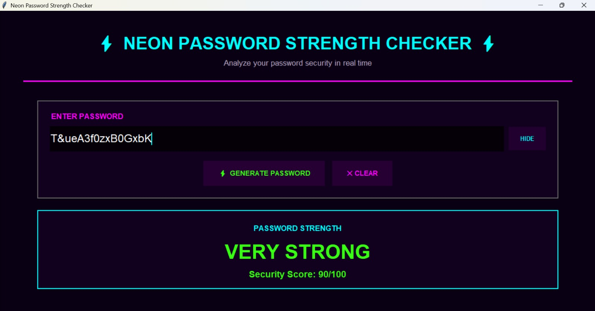

# Password Strength Checker

A Python-based password security application that evaluates password strength, identifies common and predictable password patterns, provides security recommendations, and generates secure passwords.

## Project Overview

The Password Strength Checker is a desktop application developed using Python and Tkinter. It provides an interactive interface for analyzing password security based on multiple criteria.

The application follows a modular structure, separating password analysis and generation logic from the graphical interface.

It also includes an automated test suite to verify password analysis and password generation functionality.

## Features

| Feature | Description |
|---|---|
| Password Strength Detection | Evaluates password strength using multiple criteria |
| Security Score | Assigns a score based on password characteristics |
| Common Password Detection | Identifies common and predictable passwords |
| Password Normalization | Detects certain predictable passwords using character substitutions |
| Character Analysis | Checks uppercase, lowercase, numbers, and special characters |
| Repeated Character Detection | Identifies repeated character patterns |
| Sequence Detection | Detects predictable sequences such as 1234 and qwer |
| Secure Password Generator | Generates random passwords using Python's `secrets` module |
| Show / Hide Password | Allows users to reveal or hide passwords |
| Copy Password | Copies generated passwords |
| Clear Password | Clears the current password |
| Security Suggestions | Provides recommendations for improving password strength |
| Maximized Interface | Opens the application in a maximized window |
| Neon UI | Provides a cybersecurity-inspired graphical interface |
| Automated Testing | Includes 9 tests using pytest |

## Password Strength Analysis

The application evaluates passwords using the following security factors:

- Password length
- Uppercase letters
- Lowercase letters
- Numbers
- Special characters
- Common password patterns
- Repeated characters
- Predictable sequences

Passwords are classified into five strength levels:

**Very Weak → Weak → Moderate → Strong → Very Strong**

The scoring system is a heuristic assessment and does not guarantee password security.

## Technologies Used

| Technology | Purpose |
|---|---|
| Python | Core application development |
| Tkinter | Graphical user interface |
| Regular Expressions | Password pattern detection and validation |
| Secrets | Cryptographically secure random password generation |
| String | Character set generation |
| Pytest | Automated testing |

## Application Interface

### Main Interface



### Password Analysis



### Secure Password Generation



## How to Run

### Prerequisites

- Python 3 installed on your system.

### Clone the Repository

```bash
git clone https://github.com/Sara-png-ops/password-strength-checker.git
```

### Open the Project Folder

```bash
cd password-strength-checker
```

### Run the Application

```bash
python password_checker.py
```

The application will launch in a maximized window.

## Running Automated Tests

Install pytest:

```bash
python -m pip install pytest
```

Run the test suite:

```bash
python -m pytest -v
```

### Test Coverage

The project includes 9 automated tests covering:

1. Empty password handling
2. Common password detection
3. Common passwords with suffixes
4. Predictable password detection using character substitutions
5. Strong password evaluation
6. Repeated character detection
7. Generated password length
8. Generated password character diversity
9. Invalid password generator length

**Latest verified test result: 9 passed, 0 failed.**

## Project Structure

```text
password-strength-checker/
│
├── password_checker.py
├── password_logic.py
├── test_password_logic.py
├── README.md
│
└── Screenshots/
    ├── main_interface.png
    ├── password_analysis.png
    └── password_generator.png
```

### File Description

- **password_checker.py** – Main application and Tkinter graphical interface.
- **password_logic.py** – Password analysis, common-password detection, and secure password generation.
- **test_password_logic.py** – Automated tests for password analysis and generation.
- **README.md** – Project documentation.
- **Screenshots/** – Application screenshots.

## Security Concepts Demonstrated

- Password complexity analysis
- Common and weak password identification
- Character diversity
- Password pattern recognition
- Secure random password generation
- Input validation
- Predictable sequence detection
- Security recommendations
- Automated software testing
- Modular application development

## Future Improvements

- Password entropy calculation
- Integration of a larger common-password database
- Additional password security rules
- Password history analysis
- Dark and light interface themes
- Exporting password analysis reports
- Improved accessibility
- Packaging as a standalone executable

## Learning Outcomes

Through this project, I gained practical experience with:

- Python application development
- Tkinter GUI development
- Event-driven programming
- Regular expressions
- Password security concepts
- Secure random number generation
- Modular Python programming
- Automated testing with pytest
- Git and GitHub project management

## Author

**Sara Subhan**

B.Tech Computer Science & Engineering


## License

This project is created for educational and portfolio purposes.
